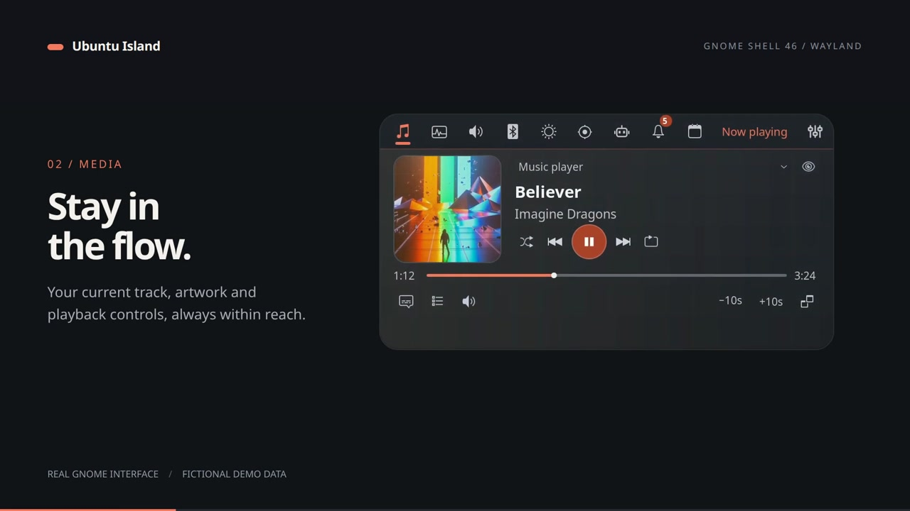

# Ubuntu Island

A compact notch for Ubuntu that expands into music controls, system stats,
sound outputs and Bluetooth devices. Add weather, commute estimates,
notifications, calendars and coding-agent tracking when you need them.

**For Ubuntu 24.04 with GNOME Shell 46 on Wayland.** Other Shell versions are not supported.

[](screenshots/demo.mp4)

[Watch the 58-second demo](screenshots/demo.mp4) — silent, with demo data.
No personal notifications or calendar events are shown.

## Installation (recommended)

Install the latest version directly from GitHub. You need `curl`, `tar`, GLib
schema tools (`glib-compile-schemas`) and Fontconfig (`fc-cache`).

```sh
curl -fsSL \
  https://raw.githubusercontent.com/mhbahmani/Ubuntu-Dynamic-Island/master/scripts/install-github.sh | sh
```

Run as your regular desktop user. The installer backs up an existing installation
and may request administrator authentication for missing Calendar dependencies.

**Log out and back in**, then enable the extension:

```sh
gnome-extensions enable ubuntu-island@mhbahmani.github.io
```

To update, run the same command and log out and back in. For local-source installs,
specific versions and troubleshooting, see the [development guide](docs/DEVELOPMENT.md#install).

## Make it yours

- Click the notch or press **Super+Alt+I** to open it. **Escape** closes it.
- Open the gear button to choose themes, transparency, notch indicators and their order.
- Enable Weather, Commute, Notifications, Calendar or experimental Agents in
  **Preferences → Modules**. Calendar applies immediately; other module changes
  need the extension disabled and re-enabled.

Open preferences directly with:

```sh
gnome-extensions prefs ubuntu-island@mhbahmani.github.io
```

## Learn more

- [Usage and settings](docs/USAGE.md)
- [Optional modules: setup, privacy and limitations](docs/MODULES.md)
- [Preview, development and hardware checks](docs/DEVELOPMENT.md)
- [Editable video project](scripts/readme-video/README.md)

Design inspired by [Ricelin](https://github.com/Gakuseei/Ricelin).
