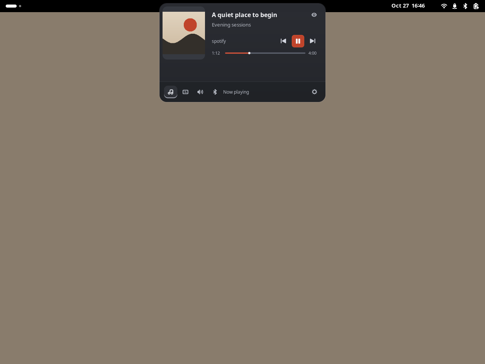

# Ubuntu Island — GNOME Shell 46 Dynamic Island

A native GNOME Shell extension implementing a macOS-style Dynamic Island for
Ubuntu 24.04-class GNOME Shell **46**, Wayland. The compact pill sits centered
at the top of the primary monitor and morphs — one single surface, no popup
window — into an expanded card with media controls, system meters, audio
output selection, Bluetooth device management, opt-in weather and commute estimates,
and an experimental local AI agent tracker.

The repository root contains the current extension. Earlier prototypes remain
available in Git history. Run installation and development commands from here.

For session continuity, read [the handoff](docs/HANDOFF.md),
[AGENTS.md](AGENTS.md), and [CLAUDE.md](CLAUDE.md). Performance and host
responsiveness take priority over new effects or features. API discovery starts
with [public-apis](https://github.com/public-apis/public-apis); verify provider
documentation for current coverage, pricing, and limits.
The v10 visual baseline was accepted on 2026-10-28. v11 includes optional Weather
and Commute, refreshed music controls, and configurable notch indicators.



More fixture renders: [System](screenshots/system.png), [Sound](screenshots/sound.png),
[Bluetooth](screenshots/bluetooth.png), [narrow media](screenshots/narrow.png),
and [compact playing pill](screenshots/playing-pill.png).

## What's included

- **Calendar (prototype, opt-in)**: choose Jalali (شمسی), Gregorian (میلادی), or
  Hijri (قمری) under **Preferences → Calendar → Main calendar**. Additional date
  switches put the selected dates together on one compact line in the header.
  The tab has a clear date heading, grouped month controls, one number per day
  and only the needed week rows. Jalali/Hijri use a Saturday-first RTL grid;
  Gregorian starts on Monday.
  Adjacent-month cells stay empty. Holiday colors follow the main calendar:
  Iranian holidays/Fridays in Jalali, Iranian Islamic dates/Fridays in Hijri,
  and Saturday/Sunday weekends in Gregorian. Selecting a named holiday shows its
  name in the header. Jalali 1405 dates follow the published calendar; other lunar
  dates are labeled as calculated estimates.
  Select a day to convert it, browse months, or return to Today.
  Arrow keys move through dates; Page Up/Down changes month, Shift+Page Up/Down
  changes year, and Home/End moves to the start/end of the week.
  Enable it in **Preferences → Modules → Calendar**, or open Calendar in `make preview`
  without installing. Hijri uses tabular calculation; local moon-sighting dates
  may differ. Read-only desktop events are available through the optional EDS
  integration; see [event setup](docs/MODULES.md#desktop-events).
  **Preferences → Notch → Dates in the notch** shows one or several calendars.
  Only the main calendar is selected initially; use the independent switches to
  choose and reorder Jalali, Gregorian and Hijri. Each has presets, custom Persian
  Calendar format codes, and a Persian/Latin numeral choice. Expand its settings
  row to edit it and see a preview. Move the whole **Dates** group in **Notch order**.
  Long formats shorten to fit; hover over dates or focus the notch to read the full text.
  The Calendar module can remain off.
  Vazir is bundled and installed per-user by `make install`, with a DejaVu Sans fallback.
  See [calendar design and checks](docs/MODULES.md#calendar).
- **Agents (experimental, opt-in)**: local Claude Code/Codex/OpenCode status events,
  attention counts, automatic window matching, optional notifications, and Quick Ask
  for CLI harnesses. No API keys or account access. Tracking needs
  optional local hooks/plugins; executable and configuration paths are detected.
  Harness icons identify sessions; working indicators rotate while visible.
  Rows open a window only when process ancestry identifies one unique target.
  Sessions reported as closed disappear automatically; finished tasks remain
  available for more prompts. A closed session report does not prove its window closed.
  A short session ID beside each status distinguishes sessions in the same
  project. The three-dot menu exposes the full ID as selectable, read-only text.
  Three-dot menus keep Hide and last-activity details in the list, with Undo.
  Finished sessions stay in the same list. **Agents → Remove inactive sessions
  after** defaults to 60 minutes; cleanup runs only when opening the Agents tab.
  A fixed Quick Ask bar keeps the list compact. Drafts survive Back; errors
  preserve the prompt.
  **Clear** in the main header removes finished sessions with Undo; the adjacent
  eye toggles agent status in the notch. The former Agent options page is removed.
  Set **Agents → Quick Ask → Quick Ask shortcut** in preferences to widen the
  notch into a compact text box. Choose an unused combination such as
  **Super+Alt+Space**, type a message, then press **Enter**. **Escape** closes it
  and keeps the draft. The shortcut also works with session tracking disabled.
  It uses your default CLI harness, desktop terminal (including Terminator), and
  project folder (initially your home folder). Explicit terminal choices remain
  available in Agents settings.
  Open Agents in `make preview`; see [setup and limitations](docs/MODULES.md#agents).
- **Single-surface morph**: one chrome-managed surface expands downward around
  its center. Notch content gently contracts inward and fades as the card or
  Quick Ask appears, without reflowing text during the transition. Opening
  eases into place; closing is slightly faster. Rapid reversals remain continuous,
  reduced motion opens/closes instantly, and fullscreen hiding snaps it closed.
  This is the accepted [motion baseline](docs/HANDOFF.md#motion-baseline) for
  future features and animations.
- **Ricelin-inspired faces**: one focused surface at a time, using matte graphite
  surfaces and Ricelin’s vermilion accent. Media opens as a compact
  horizontal artwork-and-controls face. A quiet navigation strip switches to
  system, sound, and Bluetooth faces; close and preferences remain available.
  Background opacity (default 98%, 0–100%) sets the tint; matte tone sets a
  real frosted-glass blur of the desktop behind the expanded card.
- **Keyboard navigation**: Super+Alt+I opens/closes the island; Super+Alt+Right
  and Super+Alt+Left cycle available tabs. Ctrl+Tab and Ctrl+Shift+Tab also work
  while open. Customize or disable global bindings under **Appearance → Keyboard
  shortcuts**. Regular tabs and sections share a stable expanded size.
- Click toggles; **Escape and outside clicks close** via the same modal-grab
  pattern GNOME's own popup menus use (outside presses release input
  immediately so apps receive the next click); optional hover open/close.
- **Media**: event-driven MPRIS discovery with playing-player priority, play/pause/skip,
  progress bar with seek (`SetPosition`, only when `CanSeek`), local
  `file://` artwork and **remote HTTPS artwork** through a bounded
  (2 MiB, MIME allowlist, host-validated, DNS-checked, disk-cached) loader.
  **Idle/stopped players and empty registrations are hidden**; paused tracks
  remain controllable. Seeking uses GNOME's native keyboard-accessible slider,
  with the displayed timestamp following the thumb while dragging.
  The square cover supplies a subtle static tint; a full-width timeline and round
  play control fit the same 260px surface as the other modules. The player-name
  menu selects Automatic or pins a running player, including a paused player.
  Shuffle/repeat and Open player appear when supported; ±10-second seek buttons
  are available for seekable tracks. The speaker button provides system volume,
  mute, current output and a shortcut to Sound (when that module is enabled).
  Lyrics and Up next open inside the card, with navigation fixed below them.
- **System**: CPU and RAM percentages plus RX/TX rate for the lowest-metric
  default-route interface (VPN tunnels win), read asynchronously from procfs.
  IPv6 defaults are used when no IPv4 default exists; failed reads leave gaps
  only in the affected metrics and have a bounded timeout.
  CPU and memory have fixed 0–100% history charts. Download and upload share
  a mirrored chart (download above, upload below), with an automatic shared scale.
- **Audio**: GNOME's shared Gvc mixer, volume slider, mute, and **output
  device selection through `change_output(Gvc.MixerUIDevice)`** (port/profile
  aware), seeded from existing sinks and updated through Gvc output signals.
  Recognized Bluetooth headphone outputs are grouped under one device with
  **Music** (high-quality playback, headphone mic off) and **Calls · mic**
  (headphone mic available, lower playback quality). Only available, identified
  modes are shown. Using another microphone lets you keep Music mode; merging
  the controls does not remove the Bluetooth profile trade-off.
  Outputs are ordered by headphones (Bluetooth or AUX), built-in speakers,
  HDMI/DisplayPort, then other devices. Switching outputs keeps that order.
- **Bluetooth**: event-driven BlueZ state (`GetManagedObjects` snapshot +
  `InterfacesAdded/Removed` + per-interface `PropertiesChanged`), paired
  devices with connect/disconnect, Battery1 percentage, adapter power toggle;
  pairing stays in GNOME Settings. Operations show pending states and inline
  failures. Audio and Bluetooth rows are retained across updates to preserve
  focus. A scroll container keeps controls reachable on short displays.
- **Weather (v11, opt-in)**: current conditions, feels-like temperature, humidity,
  wind, and the next four forecast entries. Open-Meteo, MET Norway and wttr.in automatically
  fall back to each other; choose either as the preferred source. City selection,
  manual coordinates, Celsius/Fahrenheit, refresh, and a bounded offline cache.
  Fetches while the Weather tab or its enabled notch indicator is visible, at most every 20 minutes automatically.
  Bundled Meteocons animations sit behind the temperature and horizontal forecast,
  with optional Off/Subtle/Live motion and automatic power-saver/reduced-motion support.
  See [weather setup, sources, and limitations](docs/MODULES.md#weather).
- **Commute (opt-in)**: saved driving routes with map-selected endpoints, optional
  current location, ETA/distance/arrival, and provider fallback. Refresh defaults
  to 15 minutes (minimum 10), only while visible. Public routing works without a
  key; optional Mapbox, openrouteservice, GraphHopper and Neshan keys add alternatives.
  See [Commute setup and provider limitations](docs/MODULES.md#commute).
  Choose the ETA source directly in the tab; reversing keeps the preference.
  Automatic defaults to Balad, then Mapbox when configured, with public OSRM as
  a last resort only without a Mapbox token. **Preferences → Commute → Open route in**
  independently chooses Google Maps, Balad or Neshan for driving directions.
- **Preferences** (`prefs.js` + GSettings): live Graphite/Ocean/Forest/Ember themes,
  background opacity (0–100%, default 98%) for the tint layer only, matte tone
  (0–100%, default 60%) for frosted-glass blur strength without changing transparency,
  a Notch order preview that uses smaller icons when labels would overflow,
  widths, animation duration,
  reduced animation, hover behavior, metrics interval, module toggles,
  remote-art toggle, clock relocation.
- Full `disable()` cleanup of timers, signal handlers, D-Bus subscriptions,
  cancellables, and chrome actors; the panel clock is restored.

In **Settings → Appearance → Open on expand**, keep **Last used tab** (default)
or choose Media, System, Sound, Bluetooth, Weather, or Commute. A fixed choice
applies each time you open the island, including hover-open. You can switch tabs
normally while it stays open. If the chosen tab is unavailable (for example, its
module is disabled or Media has no player), the island keeps the last available
tab. Preference changes take effect on the next opening.

Music's **Lyrics** button looks up the current title/artist (plus album and
length when available) on [LRCLIB](https://lrclib.net/docs). It shows timed lines
when supplied, or plain lyrics, with a full-text view. Lookup starts only while
that view is open; results stay in a bounded memory cache for the extension's
session. Closing the view cancels requests. No account or API key is needed.
Missing metadata, instrumental tracks, unavailable lyrics and connection failures
have explicit states. Lyrics availability depends on the provider's catalog.

**Up next** uses the player's optional
[MPRIS TrackList](https://specifications.freedesktop.org/mpris/latest/Track_List_Interface.html).
It displays at most 20 shared entries after the current track and can jump to one.
This is the player's reported list, which may be incomplete or differ from shuffle
order. Players that do not expose it show an explanation. Player pins last for
this extension session and return to Automatic when the chosen player disappears
or stops being eligible.

## Preview locally without installing

```sh
make preview       # full sample preview, collapsed notch, all modules enabled
make preview-offline # disconnected Wi-Fi icon with sample local modules
make preview-offline-edge # unplugged symbol and split amber underline
make preview-live  # live Tehran weather/routes and system metrics; sample devices
make preview-headless # save a screenshot without opening a window
make preview-sun-day    # sunny sample
make preview-clouds-day # cloudy sample
make preview-rain-day
make preview-snow-day
make preview-night
make preview-clouds-night
make preview-rain-night
make preview-snow-night
```

Scene shortcuts bypass power saver only in the preview; reduced motion is still
respected. Add `PREVIEW_ARGS="--headless"` to save a screenshot instead of opening a window.

This launches a nested GNOME Shell running a temporary copy of the working tree,
using the actual St/Clutter UI and stylesheet. It starts collapsed with Music,
Weather, network rates, CPU, Bluetooth, Commute, Agents and Dates enabled and populated.
Click the notch to explore all eight module tabs and open preferences. Sample playback,
seek, volume, output selection and Bluetooth controls update simulated data.
Sample Weather, routing and network status work even when the host is offline.
Use `--live` for real Weather, routing and system metrics; media/audio/Bluetooth
controls remain simulated so the preview does not switch real devices.
Open a particular module immediately with `PREVIEW_ARGS="--tab media"` (or
`system`, `audio`, `bluetooth`, `weather`, `commute`, `agents`, `calendar`).
Weather scene shortcuts open Weather automatically. The full preview includes
sample agent sessions, a simulated Quick Ask flow, a sample commute route and Calendar.
Use `make preview PREVIEW_ARGS="--tab calendar --card-width 380 --text-scale 1.5"`
to try the calendar at narrow width with enlarged text.
Agent configuration changes from preview preferences stay in temporary folders.

To inspect expansion and Quick Ask motion, use
`make preview PREVIEW_ARGS="--check-motion --duration 30"`. This isolated check
temporarily slows the animation, exercises compact/full notches at both card
widths, and checks centering, focus, reversals and reduced motion. It saves painted
frame measurements and screenshots alongside the preview log. The same flag works
with `preview-headless` for automation; it cannot be combined with other checks.

The preview window starts at **1600×1000 with 200% UI scaling**, so text, icons
and controls are larger too. Use `--scale 1` for the original 100% UI. Set the
window size independently, for example
`make preview PREVIEW_ARGS="--size 1920x1080 --scale 2"`.
At 200%, the window must be at least 1280×960. These options work with all
windowed preview targets. Headless previews keep their 1280×960/100% defaults;
they accept `--size` but do not use `--scale`. Restart an existing preview to
apply the changes.

For offline designs, use the two shortcuts above or pass
`PREVIEW_ARGS="--connection offline --offline-style icon"`. Connection choices
are `online`, `offline`, `limited`, `portal`, and `auto` (follow the host); offline
styles are `icon`, `edge`, and `hide`. These flags simulate the notch state without
changing the host connection. The style can also be changed in preview preferences.
Choose `--scene sun|clouds|rain|snow|night|clouds-night|rain-night|snow-night` and `--motion off|subtle|live` through
`PREVIEW_ARGS`. Weather motion defaults to Live in the preview; normal extension preferences default to
Subtle (four seconds). Power saver and reduced motion stop animation. The explicit
`--ignore-power-saver` flag bypasses only the preview scene’s power check and
does not change the host power profile. Reduced motion is still respected.
City search in preferences still uses the network in either mode.

No installation or logout is needed. The preview has its own session bus, settings,
and cache and does not modify the installed extension. Close its window or press
Ctrl+C in the terminal to stop. After source changes, rerun the command to load a
fresh copy (there is no automatic hot reload). Each run prints its temporary log
folder and saves `notch.png` (or the selected tab, such as `weather.png`). Preview
preferences are shared between its Shell and preferences window, but do not
persist into the next preview run.

For a screenshot without opening a window:

```sh
make preview-headless
make preview-headless PREVIEW_ARGS="--check-full --duration 30" # all tabs, sample controls, Agents
```

The nested window validates real rendering and interactions; it cannot establish
physical monitor, hardware integration, or production-session behavior.

## Install

```bash
make install
# Log out and back in (Wayland; do NOT use Alt+F2 'r'), then:
make enable
```

`make install` first installs missing `gir1.2-ecal-2.0` and
`gir1.2-edataserver-1.2` packages through Ubuntu administrator authentication
(`pkexec` runs only `apt-get`). Run it as your regular desktop user. Already
installed packages are skipped; cancelling or failing package installation leaves
the existing extension untouched. For offline/staging installs, use
`make install INSTALL_DEPS=0`.

`scripts/install.sh` compiles the GSettings schema and installs per-user under
`~/.local/share/gnome-shell/extensions/`. `make build` produces a versioned,
installable ZIP under `dist/`. The installer also copies bundled Vazir fonts into
`~/.local/share/fonts/ubuntu-island-vazir-v30.1.0` and refreshes their font cache.
When installing the ZIP manually, install its `assets/fonts/*.ttf` with your font
manager as well.

## Verify

```bash
gnome-shell --version        # 46.0
make status
make logs
```

## Development checks

```sh
make help                # all commands; also the default for plain `make`
make check               # Node tests, JS/Python syntax, strict schema validation
make smoke               # isolated GNOME rendering + interaction checks
make prefs-test          # actual GTK preferences (requires a desktop display)
make weather-cache-test  # real GJS cache round trip in a temporary directory
make media-test          # real MPRIS operations on a private D-Bus session
make agents-test         # local IPC, hooks, setup preservation and literal launch arguments
make verify              # all checks above plus building the extension ZIP
```

Preview options can be passed with `PREVIEW_ARGS`, for example
`make preview PREVIEW_ARGS="--duration 15"`. `make prefs`, `make enable`,
`make disable`, `make status`, and `make logs` operate on the installed extension;
preview commands operate on a temporary copy. None of the verification targets
installs the extension. `make install` changes installed files but does not reload
running Shell code; toggling enable/disable is not a replacement for logout/login
when that code has changed.
If an upgrade reports `GSettings key agents-destination not found`, reinstall the
current version and log out/back in. Retired settings remain in the schema for
compatibility with cached Shell code; their former UI options stay removed.

The Makefile wraps the existing scripts; they remain directly runnable. The tools
required are GNU Make, Python 3, Node.js (development only), GJS, GNOME Shell 46,
GLib schema tools, `dbus-run-session`, `timeout`, and `zip`. Native GTK checks need
the Ubuntu GNOME libraries and a working display.

`tests/smoke.py` starts a separate headless Shell with a private session bus,
runtime directory, and in-memory settings. It uses fixture media/device data,
captures every module face, and checks navigation, idle media, stable audio rows,
outside dismissal, Escape, rapid toggles, and disable cleanup. It leaves logs
and screenshots in the printed `/tmp/ubuntu-island-smoke-*` directory. It does
not replace the running desktop or switch physical audio/Bluetooth devices.

v11 verification (2026-10-28): 52 Node regressions passed; all source syntax,
strict schema compilation, ZIP integrity, and the real GNOME 46 headless smoke
test passed. The smoke includes local artwork decoding and interrupted animated
toggles. The screenshots above use fixture data and a procedural cover.
Transient Clutter allocation warnings occur during rapid fixture changes.
Live MPRIS commands, audio routing/ports, Bluetooth operations, physical
mixed-scale monitors, suspend/resume, and fullscreen applications still need
the hardware acceptance checks below.

Before release, verify click/toggle behavior, MPRIS controls, metrics, audio
routing and hotplug, Bluetooth, fullscreen hiding, suspend/resume, and mixed-scale
monitors in a live GNOME 46/Wayland session. Automated checks do not replace
these hardware acceptance checks.

## Limitations

- Matte tone uses GNOME Shell 46's `Shell.BlurEffect` in background mode on the
  expanded card only (the collapsed notch never blurs). GNOME 46 blurs rectangles,
  so the rounded corners are approximated by seven slices that stay inside the
  arc; a few corner pixels stay unfrosted. Partial repaints are widened to the
  whole card; an unexpected one can show a faint smudge for one frame before it
  is corrected. Background blur previously failed to paint on some external
  monitors: if it does, set matte tone to 0 to switch it off. At 100% opacity the
  tint hides the blur, so the effect is switched off there.
- While open, the island holds an input grab like a native menu: the one
  press that dismisses it is consumed rather than passed to the app.
- The date-menu relocation uses GNOME 46 private panel boxes
  (`Main.panel._centerBox`/`_rightBox`); other panel extensions may conflict.
- Remote art rejects redirects and non-image MIME types and stops reading at
  2 MiB. DNS is validated before connecting; DNS-to-connection TOCTOU remains.
- Audio discovery seeds one UI device per existing sink. Inactive ports that
  share a sink depend on Gvc's later output signals; test port switching on
  your hardware.
- Network metering follows one interface (the winning default route);
  aggregate multi-interface accounting is future work.

## Layout

Visual references: [Ricelin README](https://github.com/Gakuseei/Ricelin),
[media face](https://github.com/Gakuseei/Ricelin/blob/main/assets/hero.png),
and [module faces](https://github.com/Gakuseei/Ricelin/blob/main/assets/shell.png).
The GNOME implementation uses native St/Clutter widgets; Ricelin's Quickshell
components are design and architecture references rather than runtime dependencies.

```text
ubuntu-dynamic-island/
  extension.js            # GNOME Shell lifecycle and service wiring
  prefs.js                # GNOME preferences entry point
  metadata.json           # extension identity and supported Shell version
  stylesheet.css          # extension-scoped native styles
  ui/                     # island, notch, card, tabs and shared Shell widgets
  preferences/            # GTK settings pages, route map and shortcut editor
  services/               # async integrations, pure models and formatting
  helpers/                # isolated runtime subprocesses (Agents bridge/setup)
  assets/                 # packaged icons, weather artwork and desktop entry
  schemas/                # GSettings XML; compiled during install/build
  scripts/                # build/install, asset generation and routing probes
  tests/                  # Node tests, native smoke checks and preview fixtures
  docs/                   # module guide, current handoff and Google Calendar plan
  screenshots/            # README examples
  dist/                   # generated installable ZIPs (ignored by Git)
```

Keep development commands at the repository root: `make install`, `make build`,
`make check` and the preview targets are unchanged. Installed packages retain
`ui/`, `preferences/`, `services/` and `helpers/` beside the GNOME entry points;
development scripts, tests and docs are not shipped.

## Desktop calendar events

Read-only account calendars, event markers, split-view daily events and an optional upcoming
notch indicator are implemented through GNOME Online Accounts/EDS. Start with
[event setup](docs/MODULES.md#desktop-events). Live Google synchronization remains
unverified; the [implementation record](docs/GOOGLE_CALENDAR_PLAN.md) distinguishes
native fixture coverage from the remaining live acceptance checks.

## Notch indicators

Weather and System have eye buttons to show a static weather icon and compact
upload/download rates in the collapsed notch. Both default off and require their
modules to be enabled. Network rates use B/K/M/G units per second (K/M/G are
binary units) and reuse existing samples. Weather refreshes at the normal
interval while its indicator is visible. Stale weather is dimmed and described
as stale to assistive technology. No animation runs in the collapsed notch.

When the system reports a lost connection, the notch combines Weather, Network,
and Commute into one small amber connection symbol, without a text label or badge
background. It follows the first enabled indicator's position. Music, CPU, and
Bluetooth remain visible; normal indicators return when connectivity recovers.
Screen readers still distinguish Offline, limited internet, and network sign-in.
Detection uses the system connection monitor without extra polling or requests.

In **Settings → Notch → When offline**, choose:

- **Connection icon** (default): a disconnected Wi-Fi symbol, or a Wi-Fi question
  mark when network sign-in is required.
- **Broken edge**: a small unplugged symbol with a split amber underline at the
  bottom of the collapsed notch. The underline disappears while opening the card.
- **Hide unavailable indicators**: remove missing or stale weather/commute values
  and unavailable network rates, keeping fresh cached values and valid local rates.

Changes apply immediately. Previous **Offline badge** preferences migrate to
**Connection icon**. Expanded tabs retain cached data and recovery controls.

## Preferences tabs

Preferences are grouped into Appearance, Notch, Modules, Weather, Commute, Agents and Calendar tabs, with
search across settings. The Notch tab controls the music name, weather icon and
upload/download rates independently; changes apply immediately. Drag items in the
Notch order preview to arrange Music, Weather, Network, CPU, Bluetooth, Commute,
Agents, Dates, Upcoming event and Time.
Select an item and use the move buttons for keyboard reordering. Hidden items
keep their place.

**Notch → Time in the notch** adds a local clock with 24-hour or 12-hour AM/PM
format and optional seconds. Its timer stops whenever the clock is hidden.
In each Jalali/Hijri date row, **Short English month names** abbreviates months
when **Calendar → Use calendar language** is off.

The collapsed width is a minimum: the notch grows to fit enabled groups, with
single-line rates, red download arrows and green upload arrows. Each rate keeps
enough space for `500K` plus 4 logical pixels (about 1 mm), measured in the current
font and scale. Ordinary traffic changes keep that width stable. Unusually long
values can grow the slot temporarily; earlier traffic never leaves extra space.
Weather shares the same 260px expanded height as the other tabs, retaining its
background artwork, four-hour forecast and current conditions.

At the top of **Settings → Notch**, **Indicator style** offers **Network arrow shape**
and **Weather icon style**. Choose thin arrows (↑↓) or chevrons. Type a **Chevron angle** from **40° to 120°**
(default 80°); smaller angles produce sharper tips. The numeric control applies
to chevrons, while thin arrows retain their stem.
All use red for download and green for upload, softened slightly from full saturation. Choose Colorful or
Minimal outline weather icons independently. The colorful partly-cloudy icon has
a larger exposed sun; clouds share one size across day/night/rain/snow icons. Weather keeps its single footer settings
button. The route editor uses a native GTK map to avoid WebKit sandbox crashes.

Enable **Settings → Notch → Show Commute ETA** to see the selected driving route
while collapsed. Drag its Commute chip to choose its position. Refresh uses the
same 15-minute default (minimum 10), only while that indicator or the tab is visible.
A `!` marks a stale result. Provider and traffic details stay in the Commute tab;
see [routing providers and keys](docs/MODULES.md#routing-providers-and-keys).

Under **Settings → Notch → Music name**, select one title behavior: **Character
limit · trim** (default), **Scroll overflowing title**, or **Fit width to title**.
Trim mode has a 5–40 character limit (default 12). Short titles use their measured
width instead of reserving the whole limit; the configured notch width remains a
minimum. Narrow space or large fonts may still require additional ellipsis.
Scrolling moves the complete title back
and forth with a pause at each end, only while the collapsed title is visible
and animations are enabled. Fit mode grows the notch for the title, up to a
240 logical-pixel title budget and a monitor-aware growth budget (60% of monitor
width, capped at 600 logical pixels including indicators); longer text ellipsizes.
All modes preserve the music-name hide toggle and expose the full visible title
to screen readers. Changes apply immediately.
