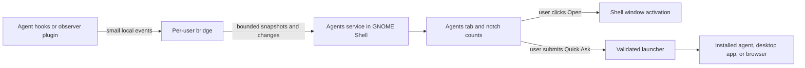

# AI agent sessions: prototype and design

Updated 2026-11-09 for GNOME Shell 46 on Ubuntu Wayland. An experimental local
prototype is implemented. The research and longer-term design below remain a
reference; the following section describes what actually ships. Competing apps
and authenticated, live agent sessions have not been exercised.

## Try the prototype

```sh
make preview # open the Agents tab
# Headless screenshot, without installing:
make preview-headless PREVIEW_ARGS='--tab agents --duration 12'
# Real local IPC, setup preservation and launch argument checks:
make agents-test
# Native input, window focus and narrow-layout checks:
make preview-headless PREVIEW_ARGS='--check-full --duration 40'
```

The preview uses three clearly labelled sample sessions and simulates Quick Ask;
it does not launch an AI request. Integration setup from preview preferences
targets temporary configuration directories. Preview settings do not configure
your real agents. No API key is needed for either preview or the local observer.

For real sessions, install using the normal README procedure, log out/in on
Wayland, then enable **Preferences → Agents → Enable Agents** and re-enable the
extension. Set a project folder, terminal, and optional desktop destinations.
For each CLI, **Review setup…** shows the exact local observer configuration;
**Enable integration** merges it with a backup. **Check**, **Remove**, and
**Test event** are available beside it. Codex also requires reviewing/trusting
the command in its own `/hooks` interface. Restart the agent after setup.
Existing sessions are not backfilled. A test event checks IPC/UI, not whether
the provider has loaded its integration.

| Implemented | Behavior and limits |
|---|---|
| Session list | Claude Code, Codex and OpenCode event adapters; a distinct icon and text for working, needs approval/input, turn finished, idle, interrupted, error, closed and unknown. Project first, provider and state second; full name and last-report time in the row menu. Capped at 32 sessions, including hidden entries. |
| Notch and notifications | Static working/attention/finished counts; reorderable and individually hideable. Optional GNOME notifications default off. No automatic focus stealing or expansion. |
| Open session | Click a session row, then choose a currently open window once; subsequent clicks focus that window. The row menu can change the binding. Closed windows lose the binding. Process ancestry ranks candidates but never authorizes automatic focus. Terminal tabs/panes inside the window still require manual selection. |
| Quick Ask | Choose agent, project, and terminal (GNOME Terminal, Console, Kitty, WezTerm). Launches with literal argument arrays and the agent's normal permissions. No shell command interpolation. |
| Global Quick Ask shortcut | Optional, unset by default. Widens the notch into a focused text box without opening the full card. Enter launches the default target; Escape keeps the draft. Works with tracking disabled. |
| Copy & open | CLI, chosen installed desktop app, or Claude/Codex website. Copies the prompt for manual paste. OpenCode has no hosted chat destination in this prototype. No typing automation or prompt-bearing browser URLs. |
| Local setup | Claude `settings.json`, Codex `hooks.json`, OpenCode `plugins/ubuntu-island-status.js`. Preserves unrelated hooks, backs up writes, removes only owned entries. Custom configuration/executable paths are supported. JSONC/invalid JSON is rejected unchanged. |

The fixed 260px card keeps the header, Quick Ask shortcut and navigation outside
the scrolling session list. Reopening sorts attention states first, then working
sessions; finished/closed entries sit in collapsed **Recent**. Incoming events
update the existing rows without moving click targets or keyboard focus. A
resumed session reveals Recent so a new request cannot remain hidden there.
Only the header's working arc animates, using a native Clutter transition with
no JavaScript frame timer. It stops in secondary views, when hidden, when the
observer disconnects, and under either system or extension reduced motion.
Row and notch icons remain static.

The header menu contains Agent settings, notch visibility and **Clear finished
sessions**. The row menu has **Hide from list**. Both offer one batch of **Undo**;
the broker retains current status while hidden, so Undo never restores an old
state over a newer event. Clear finished checks the broker's current state and
does not hide active work. Hidden entries are evicted first at the 32-session
cap; Undo restores only entries still retained. These actions never stop agents.

Quick Ask remembers the provider/destination and the last successfully launched
project folder. An unsent prompt survives Back, Escape and tab switches only in
memory; launch failures retain the draft and show an inline error. Ctrl+Enter
submits. Escape first leaves a picker/composer/menu; from the session list it
closes the island. Desktop/web destinations explicitly use copy and manual paste.

For the compact keyboard flow, open **Preferences → Agents → Quick Ask → Quick
Ask shortcut** and press an unused combination with Ctrl, Alt or Super (for
example Super+Alt+Space). Escape cancels shortcut recording; Backspace or
**Disable shortcut** clears it. Changes apply immediately. Avoid combinations
already used by the desktop or applications. Set the default agent, destination,
terminal and project in the same group. An empty project uses your home folder.

The shortcut opens a single-line prompt and focuses it directly. **Enter** starts
a new CLI session with the message; desktop/web/Copy & open terminal targets copy
the prompt and still require pasting it into the destination. The target and
behavior are shown below the entry. **Escape**, the close button or an outside
click closes the composer while retaining its draft in memory; successful launch
clears it. Errors keep the entry open. Moving the pointer away does not dismiss
it. A normal notch opening restores the usual tab. The shortcut is inactive on
the lock screen, in the overview, while Island's preferences are open, and when
the notch is hidden by a fullscreen window.
Disabling the extension removes the keybinding and clears the in-memory draft.
No hooks or new access permissions are needed for this launch-only flow.

No provider credentials, transcripts, conversation history, screen capture, browser
extension, accessibility service, model API, or telemetry is used. Hooks do receive
the provider's event payload in an isolated relay process, which discards prompt,
tool input and transcript paths before sending bounded metadata. Short project
basenames are visible. Full configuration files are parsed only by the explicitly
invoked setup helper. Prompts remain only in the editor until launch; CLI argument
inspection and clipboard history are normal local exposure paths. Use Copy & open
terminal when you prefer not to pass the prompt as a process argument.

The GJS bridge accepts short EOF-framed JSON messages on a Unix socket under
`$XDG_RUNTIME_DIR/ubuntu-island-agents/` (0700 directory, 0600 socket, UID checks).
The Shell client receives coalesced snapshots through the child's stdout pipe;
its stdin closes on disable to stop the child and remove its socket. Inputs are
capped at 4 KiB, eight concurrent clients, 100 events/second and one snapshot/second.
Hooks have a 700 ms relay deadline, do not print decisions, and fail silently when
the module is off. There are no idle polling timers, network listeners, persistent
session database or token-stream updates. Same-user processes remain within the
local trust boundary. A crash that leaves the socket behind is reported as an
unavailable observer; logout clears the runtime directory.

Current limitations: these are last **reported** states, not a process-liveness
guarantee. Forced termination or lost events can leave stale rows; hide those rows
and restart the session. Working means activity, and turn finished does not mean
the task succeeded. Concurrent same-tool approval requests may be indistinguishable
when the provider supplies no request ID. There is no universal discovery of all
open sessions, arbitrary browser/desktop chat status, or exact terminal-tab focus.
If you do not want local hooks/plugins, use Quick Ask and leave tracking disabled.

Local version discovery found Claude Code 2.1.319, Codex 0.167.0 and OpenCode
1.18.35. This is **not** a live compatibility certification. Tests exercise real
GJS IPC and setup with synthetic lifecycle events, plus a fake terminal that
captures literal arguments. OpenCode defaults to its V1 plugin API; the V2 adapter
is explicitly experimental. Provider event sequences, denied approvals, desktop
coding modes, and all four real terminal launchers still need live acceptance.
The research below describes additional compatibility and hardening goals.

The recommended feature is an opt-in **Agents** module: see local sessions that
report their state, return to their windows, and start a new request using an
already-installed agent. Ubuntu Island does not become an AI client or sign in
to providers. Monitoring itself makes no provider requests and consumes no model
tokens. Requests launched in an agent use that agent's existing authentication,
permissions, and billing.

The proposed baseline assumes optional local integration setup is acceptable.
If the user requires absolutely no agent configuration changes, provide the
launcher/window features and label session status unavailable. Do not promise
universal session discovery under that constraint.

## Comparable tools

These are useful references, not security endorsements. Features below are
reported by their maintainers; release and provider compatibility need testing.

| Tool | Relevant features | Implication for Ubuntu Island |
|---|---|---|
| [Agent Notch (Aforno)](https://github.com/Aforno/AgentNotch) | macOS notch, multiple agent providers, local event socket, observer integrations, optional permission responses; currently described as a public beta | Closest interaction and local event architecture reference. Its automatic expansion and optional responses are outside this baseline. |
| [codelight](https://github.com/henrikekblad/codelight) | GNOME/KDE panels, companion daemon, working/waiting/idle status, usage, conversation following, permission/question responses, several agents | Closest Linux integration reference. Its wider remote-control and credential/usage features exceed our scope. Its OpenCode notes differ from current upstream documentation; verify upstream interfaces independently. |
| [agent-deck](https://github.com/asheshgoplani/agent-deck) | Terminal session manager, tmux navigation, running/waiting/idle/error states, multiple providers, grouping, resume/fork, notifications | Demonstrates useful multi-session navigation. Requiring tmux or managing the user's terminal environment would be a larger product change. |
| [cmux](https://cmux.com/) | Terminal with workspace sidebar, attention badges/rings, notifications, pane navigation, CLI and socket automation | Shows why exact pane navigation is easiest when the terminal exposes an integration API. A new terminal is not required for our baseline. |
| [claude-codex-monitor](https://github.com/sotaof/claude-codex-monitor) | Local dashboard, session/subtask tracking, transcript reading, desktop integration, optional summaries | Illustrates the privacy tradeoff of log-based discovery. Its README says automatic summaries can send recent messages through a local AI CLI. Our baseline excludes transcript scanning and summaries. |

There are also [GNOME usage meters](https://github.com/wilfison/ai-usagebar), but
quota monitoring is a separate feature: that example reads existing OAuth files
or accepts API keys. Avoid treating “no new API key” as “no account access.”

## What is feasible without account access

| Capability | Baseline feasibility | Boundary |
|---|---|---|
| Open a chosen installed CLI, desktop app, or website | Yes | The target must exist; normal provider login remains the provider's responsibility. |
| Focus a known terminal/app window | Yes | Shell can activate a known window. Mapping a session to that window is separate work. |
| Enumerate every session inside arbitrary terminals/apps | No universal interface established | A window is not a session, and one process may host many sessions. |
| Working / waiting / turn finished | Yes for tested integrations | Requires local lifecycle events; process existence is insufficient. |
| Choose the exact terminal tab or tmux pane | Conditional | Requires a tested terminal/multiplexer adapter or an Island-created dedicated window. |
| Monitor desktop coding sessions | Conditional | Only if that product/version emits the tested events. Normal chat and coding sessions are distinct. |
| Monitor arbitrary browser conversations | Outside baseline | No browser extension, DOM scraping, cookies, or remote debugging. |
| Prefill/submit a new prompt | Yes for supported CLI interfaces; conditional elsewhere | Desktop/web needs a documented handoff interface; otherwise Copy & open. |
| Approve tools or answer an existing agent from the Island | Technically possible for some providers; deferred | Would turn the monitor into a control channel and needs a separate design. |

[Mutter exposes window activation](https://mutter.gnome.org/meta/method.Window.activate.html),
and this repository already uses `Meta.Window.activate()` and window signals for
preferences. [Gio.AppInfo](https://docs.gtk.org/gio/method.AppInfo.launch.html)
provides standard installed-application launching. Verify target GNOME 46
behavior, including workspace changes and the Island's modal grab, in the spike.
Do not use `xdotool`, simulated keystrokes, or accessibility/screen-recording
permission as a navigation workaround.

“No access grants” needs a precise product promise: no provider credentials,
account OAuth grant, browser extension, screen capture, or accessibility service.
A GNOME Shell extension already executes as trusted desktop code. Optional hooks
also run as the user and receive provider event payloads. This is not zero local
trust or a new sandbox. Codex additionally requires its own hook trust review.

## Proposed first release

1. **Agents tab.** Provider, short project label or user alias, state, last event
   time, and Open action. Keep different sessions in the same directory distinct.
   Show unsupported/disconnected integration states explicitly.
2. **Optional notch indicator.** Compact counts such as “2 working · 1 needs you.”
   Static icon; no perpetual spinner. Respect existing indicator order, theme,
   opacity, reduced motion, and the 260px expanded card.
3. **Return to session.** Activate its verified window. Offer a window chooser
   when ambiguous. Say “Open app” when only application-level activation is
   available, and “Select window” when there is no reliable association.
4. **Attention and completion.** Optional notifications for new input requests
   and finished turns; deduplicate by session/turn/event. Default to notch-only
   feedback to avoid duplicating the agent's notifications. Never steal focus or
   automatically expand the Island. Respect DND and hide private labels on lock.
5. **Quick Ask.** Prompt, agent, destination (Terminal / Desktop / Web), and
   project for CLI launches. Remember the selected agent/destination, not prompt
   history. Offer only destinations actually supported on the installed system.
6. **Local setup.** Integration status, version compatibility, test event,
   preview of settings changes, enable/remove integration, and Clear session data.
   Setup happens in GTK preferences or a helper, outside the Shell UI process.

An illustrative layout, using sample data:

```text
Agents                                  2 working · 1 needs you

Claude Code    ubuntu-island     Needs approval       Open
Codex          api-service       Working              Open
OpenCode       docs              Working              Open

Quick ask…                                      Preferences
```

Keep rows keyed by stable session identity. Status updates must preserve keyboard
focus; do not reorder rows under a pointer or focused control. Use text and icons
as well as color. Keep navigation outside the scrolling list. Add Agents to the
existing navigation with narrow-width coverage; a More menu is appropriate if
another tab makes controls too cramped. Do not redesign all navigation in advance.

Deferred: transcripts, task summaries, token/cost dashboards, inline approvals,
follow-up injection, automatic retries, cancellation, remote/SSH/container agent
discovery, agent orchestration, and cross-provider conversation migration.

## Status and identity rules

Keep session lifecycle, turn state, and observation health separate internally.

| Display state | Meaning |
|---|---|
| Working | A supported event reports active work. Silence is not completion. |
| Needs approval | A permission request is unresolved, subject to provider event coverage. |
| Needs input | A supported question/form event reports waiting for the user. |
| Turn finished | The response/turn ended; this does not prove the requested task succeeded. |
| Idle | A known session is available with no active turn. |
| Error / Interrupted | An explicit session/turn failure or interruption occurred. A recoverable tool failure alone is not a failed session. |
| Unknown / Disconnected | State cannot be established, events were lost, or the integration disappeared. |

Opening a finished session clears its unread badge, not its actual state. Session
closure is separate from turn completion. For shared agent servers, a live server
PID does not prove a particular session is open. Do not show every saved session
as open; label event-observed sessions “Tracked sessions” when client attachment
cannot be established.

Identity should include provider, an opaque config/profile identity, provider
session ID, and a local execution generation. Use provider turn/request IDs where
available. Preserve parent/child identity and avoid duplicate top-level rows for
subagents. Never derive identity solely from a directory, title, or PID. If a
parent finishes while a child is active, retain the child activity separately;
do not claim that all work has finished.

Record event evidence and observation health with each state. Handle duplicate,
late, and reordered events; a late Stop from an earlier turn must not overwrite
new work. Prefer provider ordering/turn IDs; broker receive order alone cannot
solve concurrent hook ordering. Where the provider lacks sufficient evidence,
show uncertainty instead of inventing a reliable transition. Define these cases
with fixtures before committing to an adapter's advertised capabilities.

## Provider integration baseline

**Claude Code:** use local command hooks for session/prompt/turn lifecycle and
permission events. `SessionStart`, `UserPromptSubmit`, `Stop`, and `SessionEnd`
are the starting set; use `PermissionRequest` for approval attention. Filter
`Notification` by type: `idle_prompt` is not a new question. Question/form and
permission-resolution coverage must be verified with installed versions. Hooks
must return no decisions or added context. [Official hook reference](https://code.claude.com/docs/en/hooks).

**Codex:** current docs expose `SessionStart`, `UserPromptSubmit`, `Stop`,
`SessionEnd`, `Interrupt`, tool and permission hooks. User hooks require review
and trust through `/hooks`; never bypass that step. Validate question detection
separately instead of assuming every approval hook covers ordinary questions.
Version-gate support. [Official hooks documentation](https://learn.chatgpt.com/docs/hooks).
Older installations may offer only a limited notification path; advertise only
events actually verified there and preserve any existing `notify` command.
[Configuration reference](https://learn.chatgpt.com/docs/config-file/config-reference).

A second Codex route is its official app-server protocol: it documents loaded
thread listing and status-change notifications, including approval waits.
This deserves a feasibility test, especially if avoiding hook setup is important.
It is not proof that a new client can passively observe every existing desktop
or CLI instance. Verify supported connection discovery, event subscriptions,
metadata exposure, and effects on thread lifetime before selecting this route.
Do not resume a thread just to monitor it or consume its approval requests.
The protocol also exposes control operations; the baseline favors the smaller
push-event interface. [App-server reference](https://learn.chatgpt.com/docs/app-server).

**OpenCode:** prefer a small observer plugin that filters events inside OpenCode
before forwarding them. V2 provides `ctx.event.subscribe()`; the API describes
execution, permission, and form events. Do not subscribe to text/token deltas.
Use separate tested V1/V2 adapters: upstream explicitly says V1 implementations
do not run unchanged in V2. [Server plugins](https://opencode.ai/docs/build/plugins/server/),
[event/API reference](https://opencode.ai/docs/api),
[migration guide](https://opencode.ai/docs/build/plugins/migrate-v1/).
Connecting Island directly to a general agent server would expose broader
capabilities than status forwarding, so it is not the default.

Treat Desktop/IDE as separate compatibility entries even when they share an
agent engine. Include minimum/maximum tested versions and per-adapter flags such
as `reportsWorking`, `reportsApproval`, `reportsQuestion`, `reportsTurnEnd`,
`reportsSessionEnd`, `canActivateWindow`, and `canLaunchWithPrompt`.
Unsupported versions degrade visibly. Never silently fall back to transcript
scraping. Existing sessions appear after a supported event or an explicit
metadata-only registration; some providers may require restart after setup.

## Implementation architecture

Recommended initial structure:



Use a small separate bridge process to validate events, keep bounded session state,
and isolate provider parsing from GNOME Shell. Prefer a standalone GJS/Gio bridge
and hook relay, with an asynchronous Gio Unix-socket client in the extension.
This reuses the project's runtime and avoids additional Python or D-Bus bindings.
Measure relay startup costs before finalizing the event set; do not spawn one
process for each generated token. No Node server, Electron process, model SDK,
database, or package download is needed for monitoring.

This choice also preserves a potential extensions.gnome.org distribution path:
its review rules discourage external processes, require careful process cleanup,
and generally require scripts to use GJS. A helper is proposed here to keep
untrusted provider payload parsing outside the desktop process; that rationale
and provider-specific plugin files still need review if publishing there.
[GNOME review guidelines](https://gjs.guide/extensions/review-guidelines/review-guidelines.html#scripts-and-binaries).

Use one versioned Unix-domain stream protocol under
`$XDG_RUNTIME_DIR/ubuntu-island-agents/`, with private directory/socket permissions
and peer-UID checks. Length-prefix frames and enforce size limits before allocating
the body. The same socket can accept short event submissions and long-lived UI
subscriptions, with distinct message types and bounded outgoing queues. No TCP
listener, loopback HTTP endpoint, browser-readable service, or network discovery.

The bridge is started only while the opted-in module needs it, owned and watched
by the extension; no always-enabled login service in the baseline. On disable,
disconnect the UI, terminate the owned bridge and remove owned runtime endpoints.
Already-installed hooks must exit successfully and quietly when no bridge is
listening. They must never restart the disabled module. Live agent processes
continue independently. On re-enable, reconnect and request fresh state; show
Unknown until a provider can re-register. Do not promise lossless monitoring
across a disabled extension or bridge crash without a resynchronization source.

This specializes the explicit-producer idea in [FEATURE_ROADMAP.md](FEATURE_ROADMAP.md).
That document proposes a D-Bus Tasks1 interface; it is not implemented. A persistent
broker could later expose that interface too. Do not bind an agent's lifetime to
an individual hook connection or D-Bus sender: hooks are short-lived processes.

Suggested file ownership:

| Location | Responsibility |
|---|---|
| `services/agents-model.js` | Pure normalization, state ordering, counts, capability rules |
| `services/agents.js` | Async bridge connection, lifecycle, snapshot delivery |
| `services/agent-windows.js` | Window signals, associations, activation, cleanup |
| `agents-view.js` | Native St session list and Quick Ask UI |
| `helpers/agents/` | Bridge, relay, launch helper, versioned provider adapters |
| `prefs.js` / focused preference module | Agent/destination choices and reversible integration setup |
| Existing `extension.js`, `card.js`, `pill.js`, schema | Opt-in lifecycle, navigation, indicator and preferences wiring |
| `tests/` | State, protocol, setup, launch and native UI coverage |

`helpers/agents/` would be a new runtime directory: update `install.sh`, `build.sh`,
and preview/test copy paths explicitly. Root `.js` files and recursive services
are already copied. Keep installation per-user with backup preservation. Install
only when the implementation is requested; test packaging with a temporary
`XDG_DATA_HOME` and inspect the ZIP contents.

## Focusing and Quick Ask

Keep **Open session** and **New request destination** separate. Choosing Codex as
the default launcher cannot transfer a Claude conversation into Codex. Likewise,
opening the right application does not imply that its correct conversation was
selected. Resume by exact session ID is a separate explicit action, offered only
when a provider supports it and concurrent-resume semantics are understood.

For Island-created CLI sessions, prefer a dedicated terminal window initially.
Capture launch correlation and associate it with a real Shell window. For
externally started sessions, use verified window/process metadata or explicit
user binding. PID ancestry and titles are hints: terminal servers can share one
PID across many windows and tabs, and shared agent daemons break simple ancestry.
Do not guess a target when multiple matches remain. Later tmux/terminal adapters
can select a known pane through that application's supported interface.

Quick Ask behavior:

| Destination | Action |
|---|---|
| Tested CLI | Open the selected terminal in the displayed project and start an interactive agent with the prompt using its supported argument/input contract. |
| Installed desktop app | Launch via its desktop entry; use a documented prompt handoff only after testing. Otherwise offer Copy & open. |
| Website | Open an allowlisted HTTPS provider page; use Copy & open by default. Do not place prompts in URLs or assume arbitrary existing tabs can be selected. |

Claude documents an initial interactive prompt, and Codex documents a positional
prompt and project directory option. These make a CLI launcher feasible without
implementing provider authentication. OpenCode launch flags must match its
installed major version. [Claude CLI](https://code.claude.com/docs/en/cli-reference),
[Codex CLI](https://learn.chatgpt.com/docs/developer-commands?surface=cli),
[OpenCode CLI](https://opencode.ai/docs/cli).

Spawn argument arrays, never interpolate the prompt into `sh -c`, shell templates,
desktop-entry text, or tmux command strings. Handle leading dashes according to
the provider parser; test option termination rather than assuming it. Preserve
newlines and Unicode. Never add flags that weaken agent permissions or trust.
The submit action should say “Start in terminal” if it starts work, and “Copy &
open” if the user must paste; do not imply a draft when the CLI submits immediately.

Prompt arguments can be visible to local process inspection. Prefer a documented
stdin/draft handoff where it preserves the interactive session; do not assume
`-p`/noninteractive modes behave that way. Always offer Copy & open for users who
do not want prompt arguments. Clipboard managers may retain copied text, so
copying must be explicit. Island itself keeps no prompt history or prompt logs.
No typing into arbitrary windows, attaching a debugger, or reading browser data.

## Security and performance requirements

- The bridge receives only normalized IDs, states, bounded project labels, event
  times, and necessary launch/window metadata. Full paths stay private unless
  needed for a selected launch. Raw hook payloads can contain prompts/tool input:
  the relay may receive them transiently but must discard them before transport
  and never log them or open `transcript_path`.
- Do not read auth files, browser cookies, keyrings, session transcripts, or agent
  databases. No telemetry, summaries, API usage queries, or credential forwarding.
- Private IPC prevents access by other normal users; it does not protect against
  malicious software running as the same user. Peer UID is not proof of provider
  identity. Validate process ownership/identity where possible; use opaque IDs
  and per-launch tokens for correlation, not as a claimed same-user sandbox.
- Status events cannot execute a command, open a URI, approve a tool, or activate
  a window. Actions require a user gesture and trusted local target definitions.
  Treat every external string as plain text with bounds, never markup or code.
- Validate runtime-directory ownership and reject symlink/socket substitution.
  Bound raw input, normalized frames, clients, sessions, queues, and event rates.
  Proposed starting limits: 256 KiB raw hook input, 4 KiB event frame, 32 tracked
  sessions and 20 recent completions. Oversize/lost input degrades observation
  health; it must not silently fabricate completion.
- Hook relay calls have a short deadline and fail without affecting agent work.
  No output that changes agent context or approval decisions. Test asynchronous
  hook ordering; async execution alone is not a correctness guarantee.
- Setup merges only owned configuration entries, validates before replacement,
  uses atomic writes and backups, preserves unrelated hooks/comments where
  applicable, and detects concurrent edits. Removal deletes only Island-owned
  entries. Unsupported configuration formats produce a manual snippet instead
  of rewriting the whole file. Never alter agent sandbox/approval settings.
- No process-table polling, terminal-output scraping, recursive log watches, or
  per-token updates. A wrapper can watch its child process; other sessions use
  lifecycle events. A long-lived shared server is not a session liveness signal.
- Passive event collection may continue while the panel is collapsed so the
  notch and next opening are correct. Hidden views do not repaint or run elapsed
  time timers. Disabled module means no listener, helper, retry, or subscription.
- Coalesce visible ordinary updates to at most once per second; prioritize an
  attention transition within that budget. Cache one state model for the tab and
  notch. Cap and back off reconnects; do not retry forever at a fixed interval.
- Benchmark against the same build with Agents disabled. Targets are no periodic
  monitoring wakeups at idle, no growth over repeated enable/disable, and bounded
  event processing under bursts. CPU, memory, latency, and battery claims require
  measurements; they have not been established by this research.

## Delivery and acceptance gates

| Step | Deliverable | Required evidence before expanding scope |
|---|---|---|
| 0. Compatibility spike | Test one real installed version of each requested agent and one terminal on GNOME 46 Wayland | Record actual event sequences, hook setup/trust, failure behavior, prompt launch and window association; evaluate passive Codex app-server attachment. Freeze a supported-version matrix. |
| 1. Vertical slice | Claude Code observer, local bridge, session list, notch counts and window activation | Two simultaneous sessions in one project; prompt, permission, question if supported, finish, interrupt, close, bridge crash and reconnect. |
| 2. Provider coverage | Codex and OpenCode adapters | Version-specific fixtures and live tests; explicit degraded capabilities; no dependency on transcripts or credentials. |
| 3. Quick Ask | CLI launch plus installed-app/web Copy & open | Test literal quotes, shell metacharacters, newlines, leading dashes, Unicode, missing binaries, launch failure, project selection and explicit copy behavior. |
| 4. Release hardening | Setup/removal, packaging, native layout and performance | All relevant checks below; publish tested limits rather than claiming universal support. |

Protocol/model coverage: duplicates, out-of-order events, two profiles with the
same session ID, subagents, PID reuse, stale generations, unanswered permission
with other work still running, a Stop hook followed by more work, malformed and
oversized frames, spoofed action fields, event floods and slow subscribers.

Lifecycle/native coverage: repeated enable/disable, hide/collapse, suspend/resume,
screen lock, bridge termination, unsupported terminal, multiple tabs/windows,
cross-workspace activation, grab release before focus, keyboard navigation,
stable focus during updates, narrow width and 150% text, empty/unconfigured/error
states, and no automatic focus stealing.

Setup/packaging coverage: temporary agent config directories, preservation of
existing hooks and custom config homes, repeated install/remove, concurrent edit
detection, disabled hooks returning quietly, `make check`, relevant preference
and native smoke checks, `node --test tests/install.test.mjs`, and ZIP inspection.
Run installation checks under temporary `XDG_DATA_HOME`, never against the user's
installed extension just to test.

The first implementation decision to confirm is optional local hooks versus
launcher-only operation. Recommended defaults are observer-only integrations,
CLI status support first, explicit Copy & open fallback, no credential access,
and no replies or approvals from the Island.
