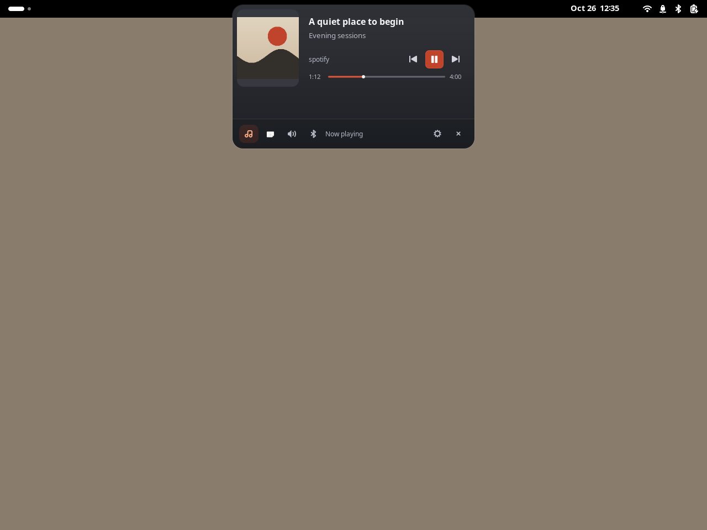

# Ubuntu Island — GNOME Shell 46 Dynamic Island

A native GNOME Shell extension implementing a macOS-style Dynamic Island for
Ubuntu 24.04-class GNOME Shell **46**, Wayland. The compact pill sits centered
at the top of the primary monitor and morphs — one single surface, no popup
window — into an expanded card with media controls, system meters, audio
output selection, and Bluetooth device management.

This is the current implementation tree (the `ubuntu-island-gnome46-*`
directories next to it are earlier prototypes kept for reference).



More fixture renders: [System](screenshots/system.png), [Sound](screenshots/sound.png),
[Bluetooth](screenshots/bluetooth.png), [narrow media](screenshots/narrow.png),
and [compact playing pill](screenshots/playing-pill.png).

## What's included

- **Single-surface morph**: the pill and the card are two children of one
  chrome-managed `St.Widget`, animated with width/height/opacity tweens
  (`COLLAPSED → EXPANDING → EXPANDED → COLLAPSING`), interrupt-safe under
  rapid toggling, snapping closed when hidden over fullscreen windows.
- **Ricelin-inspired faces**: one focused surface at a time, using matte graphite
  surfaces and Ricelin’s vermilion accent. Media opens as a compact
  horizontal artwork-and-controls face. A quiet navigation strip switches to
  system, sound, and Bluetooth faces; close and preferences remain available.
  Surfaces are 98–99% opaque, avoiding the previous monitor-dependent backdrop path.
- Click toggles; **Escape and outside clicks close** via the same modal-grab
  pattern GNOME's own popup menus use (outside presses release input
  immediately so apps receive the next click); optional hover open/close.
- **Media**: event-driven MPRIS discovery with playing-player priority, play/pause/skip,
  progress bar with seek (`SetPosition`, only when `CanSeek`), local
  `file://` artwork and **remote HTTPS artwork** through a bounded
  (2 MiB, MIME allowlist, host-validated, DNS-checked, disk-cached) loader.
  **Idle/stopped players and empty registrations are hidden**; paused tracks
  remain controllable. Seeking uses GNOME's native keyboard-accessible slider.
- **System**: CPU and RAM percentages plus RX/TX rate for the lowest-metric
  default-route interface (VPN tunnels win), read asynchronously from procfs.
- **Audio**: GNOME's shared Gvc mixer, volume slider, mute, and **output
  device selection through `change_output(Gvc.MixerUIDevice)`** (port/profile
  aware), seeded from existing sinks and updated through Gvc output signals.
- **Bluetooth**: event-driven BlueZ state (`GetManagedObjects` snapshot +
  `InterfacesAdded/Removed` + per-interface `PropertiesChanged`), paired
  devices with connect/disconnect, Battery1 percentage, adapter power toggle;
  pairing stays in GNOME Settings. Operations show pending states and inline
  failures. Audio and Bluetooth rows are retained across updates to preserve
  focus. A scroll container keeps controls reachable on short displays.
- **Preferences** (`prefs.js` + GSettings): widths, animation duration,
  reduced animation, hover behavior, metrics interval, module toggles,
  remote-art toggle, clock relocation.
- Full `disable()` cleanup of timers, signal handlers, D-Bus subscriptions,
  cancellables, and chrome actors; the panel clock is restored.

## Install

```bash
./install.sh
# Log out and back in (Wayland; do NOT use Alt+F2 'r'), then:
gnome-extensions enable ubuntu-island@example.local
```

`install.sh` compiles the GSettings schema and installs per-user under
`~/.local/share/gnome-shell/extensions/`. `./build.sh` produces a versioned,
installable zip.

## Verify

```bash
gnome-shell --version        # 46.0
gnome-extensions info ubuntu-island@example.local
journalctl --user -b | grep -i 'Ubuntu Island\|ubuntu-island'
```

## Development checks

```bash
node --test                    # pure-function tests (Node is a dev tool only)
for f in *.js services/*.js; do node --check "$f"; done
glib-compile-schemas --strict --dry-run schemas
python3 tests/smoke.py          # isolated GNOME 46 render + interaction smoke test
```

`tests/smoke.py` starts a separate headless Shell with a private session bus,
runtime directory, and in-memory settings. It uses fixture media/device data,
captures every module face, and checks navigation, idle media, stable audio rows,
outside dismissal, Escape, rapid toggles, and disable cleanup. It leaves logs
and screenshots in the printed `/tmp/ubuntu-island-smoke-*` directory. It does
not replace the running desktop or switch physical audio/Bluetooth devices.

v4 verification (2026-10-25): 26 Node regressions passed; all source syntax,
strict schema compilation, ZIP integrity, and the real GNOME 46 headless smoke
test passed. The smoke includes local artwork decoding and interrupted animated
toggles. The screenshots above use fixture data and a procedural cover.
Transient Clutter allocation warnings occur during rapid fixture changes.
Live MPRIS commands, audio routing/ports, Bluetooth operations, physical
mixed-scale monitors, suspend/resume, and fullscreen applications still need
the hardware acceptance checks below.

Runtime acceptance tests (click/toggle, MPRIS control, metrics plausibility,
audio routing, Bluetooth, rapid toggling, fullscreen hiding) follow the
A01–A18 suite in the repository-level `HARNESS_SPEC.md`. GNOME Shell
46/Wayland runtime verification on a live session is still required — the
syntax, parser, and API checks here do not replace it.

## Limitations

- The matte surface is deliberately high-opacity; wallpaper blur is not used.
- While open, the island holds an input grab like a native menu: the one
  press that dismisses it is consumed rather than passed to the app.
- The date-menu relocation uses GNOME 46 private panel boxes
  (`Main.panel._centerBox`/`_rightBox`); other panel extensions may conflict.
- Remote art rejects redirects and non-image MIME types and stops reading at
  2 MiB. DNS is validated before connecting; DNS-to-connection TOCTOU remains.
- Audio discovery seeds one UI device per existing sink. Inactive ports that
  share a sink depend on Gvc's later output signals; test port switching on
  your hardware.
- Network metering follows one interface (the winning default route);
  aggregate multi-interface accounting is future work.

## Layout

Visual references: [Ricelin README](https://github.com/Gakuseei/Ricelin),
[media face](https://github.com/Gakuseei/Ricelin/blob/main/assets/hero.png),
and [module faces](https://github.com/Gakuseei/Ricelin/blob/main/assets/shell.png).
The GNOME implementation uses native St/Clutter widgets; Ricelin's Quickshell
components are design and architecture references rather than runtime dependencies.

```
ubuntu-island/
  extension.js            # lifecycle, service wiring, clock relocation
  island.js               # morphing surface + interaction state machine
  card.js                 # expanded content sections
  pill.js                 # compact pill content
  widgets.js              # shared St widget factories
  prefs.js                # preferences dialog (GSettings)
  stylesheet.css          # extension-scoped styles
  metadata.json
  schemas/                # GSettings schema (compiled at install)
  services/
    media.js              # MPRIS + progress/seek model
    art.js                # bounded artwork loader + cache (Soup 3, async)
    system.js             # procfs sampling on a timer
    proc.js               # pure parsers (Node-tested)
    urlguard.js           # pure URL/host safety checks (Node-tested)
    format.js             # pure time/hash helpers (Node-tested)
    presentation.js       # pure geometry, player selection, layout signatures
    audio.js              # Gvc mixer control (shared singleton)
    bluetooth.js          # event-driven BlueZ client
  tests/                  # node --test suite
  install.sh / build.sh   # per-user install / zip packaging
  README.md
```

### v5 refinements

Noto Sans, matte graphite surfaces, and a fixed footer retain Ricelin’s compact
media composition. Idle notches omit the name and music placeholder. Preferences
use the GNOME 46 resource path. Actor dimensions follow the Shell theme scale,
and unavailable HDMI ports are filtered with live availability updates.

Verification includes 26 Node tests, preferences module import, and headless
GNOME rendering with twelve real pointer hover/click cycles and 200% scaling.
Physical mixed-monitor and HDMI hotplug acceptance still need a session reload.
